  

  <a href="https://salmaml56.github.io/"><b>Portfolio</b></a> &nbsp;·&nbsp;
  <a href="https://www.linkedin.com/in/salma-bibi-5a3190267"><b>LinkedIn</b></a> &nbsp;·&nbsp;
  <a href="mailto:salmamldev56@gmail.com"><b>Email</b></a>

  

## Hi, I'm Salma

I'm an AI Engineer at **Quantlix**, an agentic AI lab in Islamabad. We build long-running AI agents for climate, energy and agriculture. These agents sit on top of sensor and grid data and take multi-step action instead of only answering questions.

Most of my time goes into turning research-grade models into systems that hold up in production: agent workflows with tracing, RAG pipelines, voice assistants, and backends that handle login and permissions properly. Getting a model to work once is easy. Making it work every day, with checkpoints, evals and a person in the loop when it matters, is the job.

## What I'm working on now

- **Wasl backend:** a FastAPI, PostgreSQL and Keycloak API for sign-in, onboarding, sessions and tenants. The Phase 02 onboarding module is done.
- **Research Copilot:** a LangGraph multi-agent system with self-hosted Langfuse and OpenTelemetry, so every step, cost and failure can be traced.

## Projects

| Project | What it does | Stack |
| --- | --- | --- |
| **Wasl Backend** | Identity and access API with Keycloak sign-in, secure sessions, CSRF protection, idempotent writes and versioned schema | FastAPI, SQLModel, PostgreSQL, Alembic, Keycloak |
| **Research Copilot** | Planner, researcher and writer agents with full observability. Fixed a gap where 0 of 71 spans carried session context | LangGraph, OpenTelemetry, Langfuse, Docker Compose |
| **[AI Voice Assistant](https://github.com/SalmaML56/ai-voice-doc-assistant)** | Ask a PDF a question by voice and hear the answer, served as a multi-user backend with background jobs | FastAPI, Qdrant, Celery, Redis, faster-whisper, Groq |

## Where I've worked

**AI Engineer, Quantlix** · Sept 2026 to now
Self-hosted observability for a multi-agent system, trace-context fixes across 9+ reviewed pull requests, and the Wasl backend.

**AI Engineer, ClickTake Technologies** · Apr to Aug 2026
Built a GDPR-compliant multi-tenant SaaS on Next.js 14 and MongoDB with role-based access across 4 tiers and no cross-tenant leaks. Compound indexes cut page loads from about 2s to under 0.8s.

**AI Automation Engineer, TheEduAssist** · Oct 2025 to Jan 2026
Shipped an NLP kiosk for 200+ users with 87% session completion, plus a safety layer on the Hugging Face Inference API.

**ML Engineer Intern, Technocolabs Softwares** · Apr to Jun 2025
Built an XGBoost delivery ETA model on 50K+ records. Error dropped 23% and F1 rose from 0.71 to 0.89. Served from FastAPI on Hugging Face Spaces at sub-200ms latency.

## Toolkit

**Languages:** Python, SQL, JavaScript, TypeScript, Dart
**AI / ML:** Scikit-learn, XGBoost, LightGBM, TensorFlow, Transformers, BERT, Whisper, sentence transformers
**GenAI and agents:** LangGraph, RAG, OpenAI, Gemini and Groq APIs, Hugging Face, FAISS, Qdrant, Playwright
**Backend and DevOps:** FastAPI, SQLModel, Alembic, Keycloak, Node.js, Next.js, Docker, GitHub Actions, Celery, Redis, Langfuse
**Databases:** PostgreSQL, MongoDB, MySQL, ClickHouse

## Education

B.S. in Software Engineering, Virtual University of Pakistan · CGPA 3.35 / 4.00 · 2025

## Get in touch

I'm open to remote AI and ML engineering roles, and I'm happy to talk RAG, agents, NLP or MLOps. Email is the fastest way to reach me: **salmamldev56@gmail.com**
